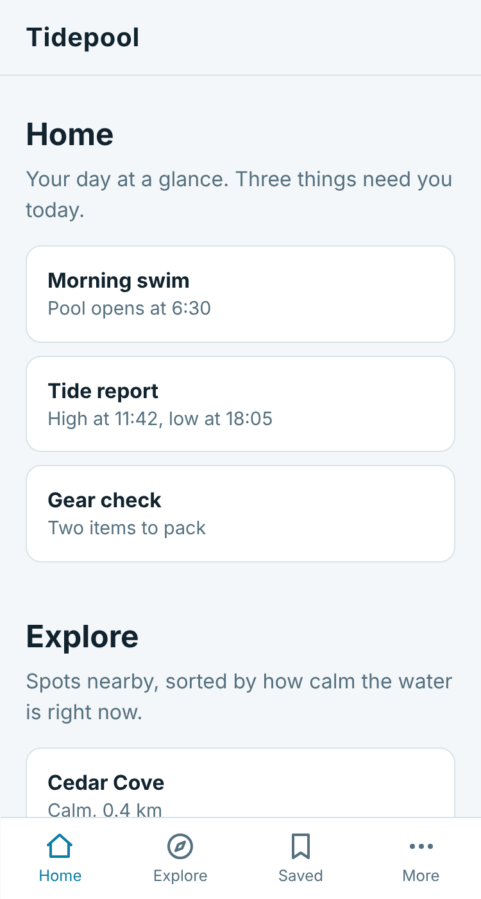
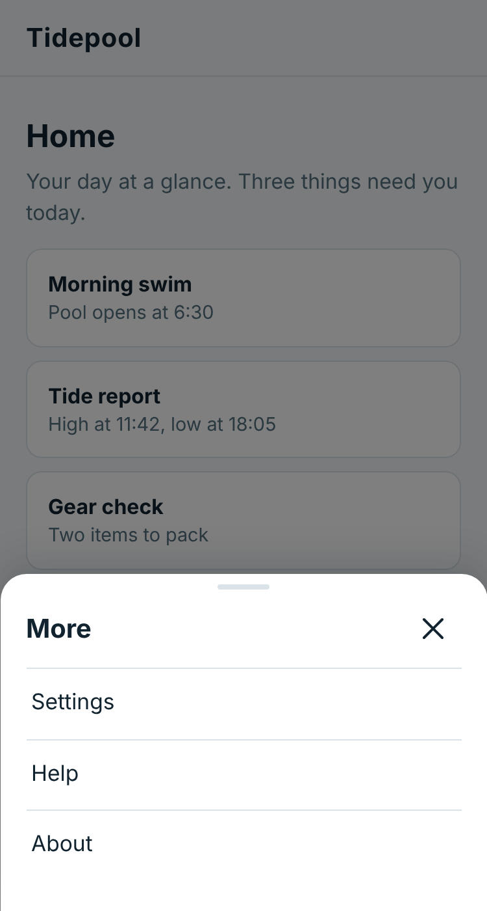

# Tidepool

A mobile app shell with a bottom tab bar and an accessible slide-up menu, in plain HTML, CSS and JavaScript. No frameworks and no build step.

**Live demo:** https://adityaayushman.github.io/NETFLIX-MOBILE-NAVIGATION/

| Menu closed | Menu open |
|---|---|
|  |  |

## What it does

- A bottom tab bar with Home, Explore, Saved and a **More** button.
- **More** opens a bottom sheet with Settings, Help and About. Tap the close button, tap the dimmed backdrop, press Escape or pick a link to close it.
- Light and dark themes follow the system setting.
- On wide screens the app stays in a phone-width column.

## Accessibility

- The sheet is a modal dialog: the page behind it is `inert`, Tab wraps inside the sheet, and focus returns to **More** when it closes.
- **More** reports `aria-expanded`, and the current tab uses `aria-current`.
- Visible focus outlines, safe-area padding for notched phones and `prefers-reduced-motion` support.

## Run it

Open `index.html` in a browser, or serve the folder:

```bash
npx serve .
```

## Tests

```bash
npm install
npx playwright install chromium
npm test
```

The Playwright tests cover opening, closing (button, backdrop, Escape), the focus trap, focus return, link navigation and the current-tab marker. GitHub Actions runs them on every push to `main` and on pull requests.

## Files

| File | Purpose |
|---|---|
| `index.html` | Markup and inline SVG icons |
| `style.css` | Theme tokens, layout, tab bar and sheet transitions |
| `script.js` | Sheet open and close, focus handling, current tab |
| `tests/menu.test.js` | Playwright tests |
| `.github/workflows/test.yml` | CI |
