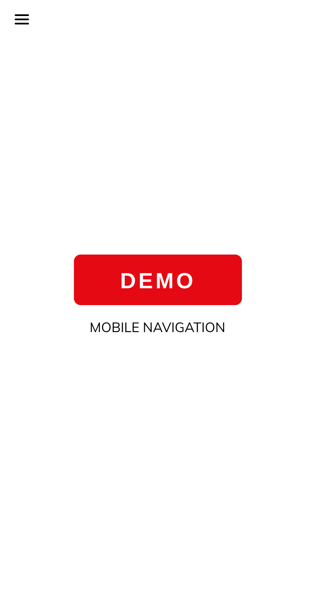
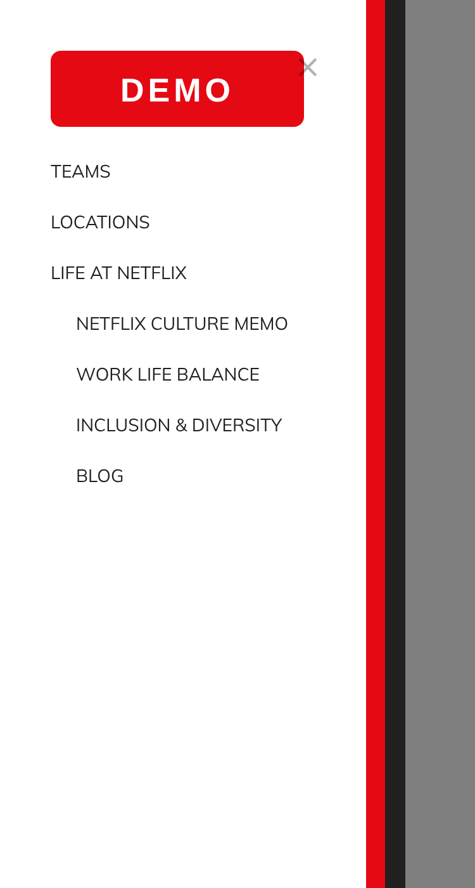

# Netflix Mobile Navigation

**Live demo:** https://adityaayushman.github.io/NETFLIX-MOBILE-NAVIGATION/

A layered, animated mobile navigation menu in plain HTML, CSS and JavaScript, built while following the course. No frameworks, no build step.

## Behaviour

A menu button opens a full-screen navigation made of three stacked panels (black, red, white) that slide in one after another. A close button slides them away. Best viewed at a phone-sized width.

## Run it

Open `index.html` in any modern browser, or serve the folder with a static server:

```bash
npx serve .
```

## Files

| File | Purpose |
|---|---|
| `index.html` | Markup, with inline SVG icons |
| `logo.svg` | Neutral placeholder logo |
| `tests/menu.test.js` | Playwright tests for open, close, Escape and focus handling |
| `style.css` | Layout and the staggered slide-in transition |
| `script.js` | Opens and closes the menu, and manages focus, `aria-expanded` and the Escape key |

## Screenshots

| Menu closed | Menu open |
|---|---|
|  |  |

## Tests

```bash
npm install
npx playwright install chromium
npm test
```

The same tests run in GitHub Actions on every push and pull request.

## Notes

This is a UI exercise. It is not affiliated with or endorsed by Netflix, and the logo and brand names belong to their owners.

## Credits

This is an exercise from the [50 Projects in 50 Days](https://github.com/bradtraversy/50projects50days) course by Brad Traversy (original: `netflix-mobile-navigation`). The code started as the original, with accessibility improvements added: button labels, `aria-expanded`, a menu that is inert while closed, focus management, close on Escape, a visible focus outline and reduced-motion support. It is used under the MIT license in `LICENSE`.
